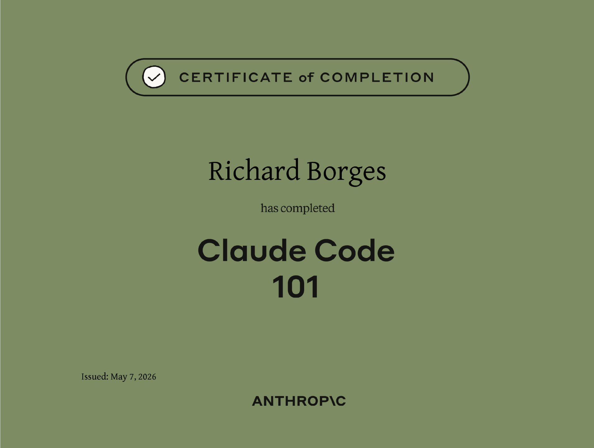

# Claude Code 101 | anthropic | 2026
- [https://anthropic.skilljar.com](https://anthropic.skilljar.com)

## What is Claude Code?
1. agentic tool
1. access resources
1. context window (working memory)
1. permissions
1. agentic loop
1. compacting context

## Your first prompt
1. installing claude code
    1. vs code extension
1. claude desktop
1. web
1. auto-accept, approval, plan-mode

## Daily workflows
1. explore > plan > code > commit
1. claude code chrome extension
1. context window (compacting, /compact, /clear, /context)
1. removing bias
1. skills are better than mcps
1. code reviews

## Customizing Claude Code
1. the claude.md file
    1. levels (user, project)
    1. add topics as memoires
    1. keep it compact
1. subagents
    1. main context window x separete context window
    1. create subagents
1. skills
    1. how todo something once
    1. scripts, instructions
    1. personal skills, project
    1. loaded on demand
    1. specialized context
    1. repeated tasks
1. MCP
    1. external content
    1. external actions
    1. claude mcp add
    1. scopping (local, user, project)
1. Hooks
    1. deterministic
    1. run scripts
    1. formatting
    1. submit, pre, post, notification, stop

## Certificate

